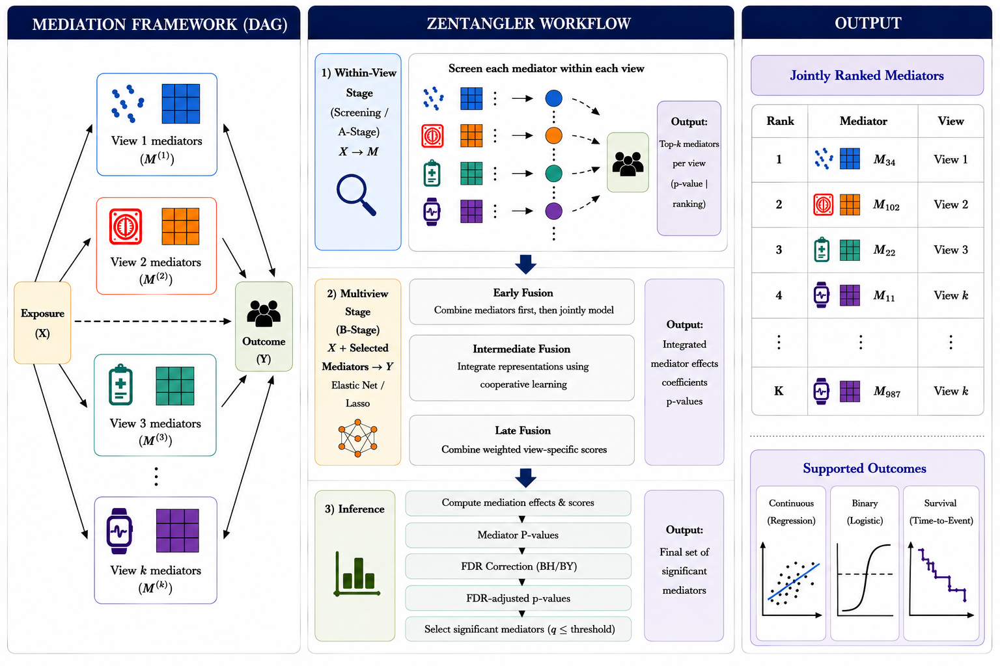

# Zentangler

Zentangler is an R package for **multi-view mediation analysis** with
`MultiAssayExperiment` input: one exposure, many candidate mediators measured
across several data modalities (species, KOs, metabolites, transcripts,
proteins, ...), and one outcome.

```text
parallel:    X -> M_j (view k) -> Y
sequential:  X -> M1 -> M2 -> ... -> Mk -> Y
```



## Installation

```r
# install.packages("remotes")
remotes::install_github("himelmallick/Zentangler")
```

Zentangler uses `multiview` (cooperative learning), which needs `glmnet >= 5.0`.

## Quick start

```r
library(Zentangler)

fit <- zentangler(
  mae, x_var = "X", y_var = "Y", covariates = "age",
  transform = c(species = "clr"),   # optional per-view log / CLR transform
  sis_n = 50
)

fit                                         # short overview
summary(fit)                                # model, per-view counts, active mediators, effects
zentangler_mediators(fit, q_threshold = 0.1)   # significant mediators
zentangler_mediators(fit, top = 20)            # top 20 by |a * b|
zentangler_effects(fit)                     # NDE, NIE, TE, proportion mediated
```

### Progress messages and the exposure-outcome check

With `verbose = TRUE` (the default) every fit prints timestamped progress:
samples and features per view, the A-stage and screening counts per view, the
chosen `rho` with its cross-validation errors, the B-path and FDR methods, the
number of active mediators at q <= 0.05 / 0.10 / 0.25, the causal effects,
and bootstrap or permutation progress. Use `verbose = FALSE` (or
`suppressMessages()`) to silence it.

Each fit first tests whether the exposure and the outcome are associated
(`Y ~ X + covariates`: linear, logistic or Cox). The result is logged, shown by
`print()` and `summary()`, and stored in `fit$diagnostics$exposure_outcome`.
It is reported, not used as a gate: indirect effects can exist without a
significant total effect (for example, mediated paths of opposite sign), but
then the total effect and proportion mediated should be read with care.

```text
[Zentangler 17:33:07] Exposure-outcome association (linear model, Y ~ X + covariates): coefficient 4.468, p = 1.07e-68; ...
[Zentangler 17:33:07]   Exposure and outcome are associated (p < 0.05).
[Zentangler 17:33:07] A-stage (exposure -> mediator) and screening:
[Zentangler 17:33:07]   species [maaslin2]: 150 features, 17 with p_a < 0.05, 15 screened in
[Zentangler 17:33:07] Outcome model: multiview cooperative learning (tuning rho by CV) ...
[Zentangler 17:33:07]   rho chosen = 0.4 (CV error by rho: 0:1.137, 0.2:1.102, 0.4:1.095, ...)
```

## The exported functions

| Function | Purpose |
| --- | --- |
| `zentangler()` | main entry point: `model = "parallel"` (default) or `"sequential"` (with `route`) |
| `fit_multiview_parallel_zentangler()` | the parallel model, with all of its options documented |
| `fit_sequential_zentangler()` | the sequential model, with all of its options documented |
| `zentangler_mediators()` | mediator table of a parallel fit (filter by `q_threshold`, `top`, `order_by`) |
| `zentangler_paths()` | path table of a sequential fit (same filters) |
| `zentangler_effects()` | one-row causal effect summary (both fit types) |
| `summary()`, `print()` | methods for both fit classes |
| `run_negative_controls()` | outcome-permutation negative controls (`model` as in `zentangler()`) |
| `run_direction_check()` | forward vs reverse hypothesis check (`model` as in `zentangler()`) |

## How a parallel fit works

1. **Align** samples across views (`MultiAssayExperiment` sample map) and the
   phenotype data in `colData(mae)`, optionally log- or CLR-transforming views.
2. **A-path** for every feature: `M_j ~ X + covariates` (`a_stage_model = "lm"`,
   or `"maaslin2"` with any MaAsLin2 option, e.g. random effects).
3. **Screen** the top `sis_n` features per view by standardized `|a|`
   (`sis_rank = "pvalue"` ranks by p-value; `screen_method = "none"` keeps all).
4. **Outcome model** `Y ~ X + covariates + screened mediators` with multiview
   cooperative learning; `rho` (0 = early fusion, 1 = late fusion) and the
   lasso penalty are tuned by cross-validation.
5. **B-path inference**: de-biased lasso (default) or full-pipeline bootstrap.
6. **FDR** for the composite null `a = 0 or b = 0` with an HDMT-style
   procedure.
7. **Causal effects** (NDE, NIE, TE) for the significant mediators by
   g-computation.

### Input

- one experiment per view; assays numeric, features x samples (they are
  transposed internally);
- phenotype columns (exposure, outcome, covariates) in `colData(mae)`;
- samples missing from any analysed view, or with missing phenotype values,
  are dropped; features with any non-finite value or zero variance are dropped.

### Transformations (log, CLR)

Count and compositional views (taxa, KOs, pathways) are usually analysed on a
log-ratio scale. `transform` takes `"none"` (default), `"log"` or `"clr"`
(centered log-ratio: `log(x + pseudocount)` minus each sample's mean log value
within the view), either once for all views or per view:

```r
fit <- zentangler(mae, x_var = "X", y_var = "Y",
                  transform = c(species = "clr", kos = "clr", metabolites = "log"),
                  pseudocount = c(species = 0.5))   # default: half the smallest positive value
```

CLR and log need non-negative data. The transform is applied to the whole view
before feature filtering and screening, and is recorded in
`fit$settings$mae_view_map`. If you also use MaAsLin2, leave its own
`transform` at `"NONE"` to avoid transforming twice.

### A-stage models (per view)

`a_stage_model` chooses how the exposure -> mediator path is estimated:
`"lm"` (default) or `"maaslin2"`. Give one value for every view, or a vector
named by view to mix models; views you leave out use `"lm"`. Only the A-stage
changes; screening, the outcome model and inference are the same for all
views.

```r
fit <- zentangler(mae, x_var = "X", y_var = "Y",
                  a_stage_model = c(species = "maaslin2", kos = "maaslin2", metabolites = "lm"),
                  maaslin2_args = list(random_effects = "SubjectID"))
```

In the sequential model only the first route layer has an A-path, so only its
entry is used (`fit$settings$a_stage_model_layer1`). The model used for each
view is reported in `summary(fit)$views`.

### MaAsLin2 A-stage

`a_stage_model = "maaslin2"` runs the A-path with `Maaslin2::Maaslin2()`.
`maaslin2_args` is passed straight through, so every MaAsLin2 argument is
available (`random_effects`, `normalization`, `transform`, `analysis_method`,
`reference`, `min_prevalence`, `output`, ...). Unknown names are rejected.
Zentangler supplies the data, adds the exposure and covariates to
`fixed_effects`, and defaults to no normalization or transformation, `"LM"`
and no prevalence/abundance filtering.

`maaslin2_args` is either one list shared by every MaAsLin2 view or a list
named by view, so each view can have its own MaAsLin2 settings:

```r
maaslin2_args = list(
  species = list(random_effects = "SubjectID", normalization = "TSS", transform = "LOG"),
  kos     = list(random_effects = "SubjectID", analysis_method = "LM")
)
```

```r
fit <- zentangler(mae, x_var = "X", y_var = "Y", covariates = "age",
                  a_stage_model = "maaslin2",
                  maaslin2_args = list(random_effects = "SubjectID",
                                       analysis_method = "LM",
                                       output = "maaslin2_out"))
```

### Outcomes

| `y_family` | Required columns | Outcome model |
| --- | --- | --- |
| `"gaussian"` | `y_var` | linear |
| `"binomial"` | `y_var`, coded 0/1 | logistic |
| `"survival"` | `survival_time_var`, `survival_event_var` (0/1) | Cox |

### Study designs

`study_design = "standard"` uses a numeric `x_var`. The other designs derive a
0/1 exposure: `"case_control"` (`case_var`, `case_level`, `control_level`),
`"time"` (`time_var`, `time_ref`, `time_compare`) and `"case_control_time"`
(both, with `exposure_role = "case"`, `"time"` or `"interaction"`). Reference
levels must be given explicitly for character columns, or the column must be a
factor whose first level is the reference; Zentangler never picks them
alphabetically.

## Outcome model: multiview cooperative learning

```text
loss(Y, X g + C d + sum_k M_k b_k)
  + (rho / 2) * sum_{k<l} || M_k b_k - M_l b_l ||^2  +  lambda * ||b||_1
```

The outcome model is fitted with the `multiview` package. `rho` runs from 0 to
1: `rho = 0` is early fusion (one lasso over all views), `rho = 1` is late
fusion (view-wise fits pushed to agree), and values in between trade the two
off. Rather than fixing a fusion type, Zentangler chooses `rho` by
cross-validation over `rho_grid = c(0, 0.2, 0.4, 0.6, 0.8, 1)` on shared folds
(deviance for binomial/Cox, MSE for Gaussian), then `lambda` by
`lambda_choice`. The chosen value and the CV table are in
`fit$settings$rho_used` and `fit$settings$rho_cv`; `rho = 0.5` fixes it.
Exposure and covariates are unpenalized; the agreement penalty acts on
covariate-adjusted view contributions. `glmnet_alpha` sets lasso (1) /
elastic net / ridge (0).

| `fusion` | Role | Description |
| --- | --- | --- |
| `"multiview"` (default) | main | cooperative learning with `rho` in [0, 1] tuned by CV |
| `"integrated_learner"` | supplementary | IntegratedLearner-style fusion: `integrated_learner_fusion = "late"` (per-view models stacked on the link scale with cross-fitted predictions and non-negative weights) or `"early"` (one `glmnet` model over all views) |

With `multiview` 1.0, Cox fits with `rho > 0` do not converge. Zentangler drops
non-converged `rho` values with a warning, so survival outcomes currently use
`rho = 0`.

## B-path inference

| `b_inference` | What it does |
| --- | --- |
| `"debiased"` (default) | one-step de-biasing (de-sparsified lasso) of the fused outcome model, starting from the cooperative fit, for every screened mediator. Gaussian and logistic outcomes use nodewise-lasso de-biasing; Cox outcomes the de-sparsified partial-likelihood estimator. `b` is the de-biased estimate, `b_fusion` the fusion coefficient. |
| `"bootstrap"` | full-pipeline bootstrap (`bootstrap_repeats > 0`): screening and the outcome model are re-run per replicate; `p_b` inverts the percentile interval of the fusion coefficient, counting non-selection as `b* = 0`. |

## FDR for the mediation null

A mediator is real only if both legs are non-zero, so the null hypothesis is
composite: `H0: a = 0 or b = 0`. Zentangler offers two ways to control the FDR
of this joint test.

| `fdr_joint` | Method | Power |
| --- | --- | --- |
| `"hdmt"` (default) | Composite-null FDR in the spirit of HDMT (Dai, Stanford & LeBlanc 2020), the procedure used by HIMA2, adapted to the screened design | higher |
| `"maxp"` | Benjamini-Hochberg / BY on the joint-significance p-value `max(p_a, p_b)` | conservative |

Why `maxp` is conservative: BH on `max(p_a, p_b)` charges every feature as if
it could be a false discovery at rate `t`. But a feature with `a = 0` can only
be a false discovery if its `p_a` is small by chance *and* its `p_b` is small,
and most features are null on both legs (false-discovery rate about `t^2`).
`"hdmt"` estimates how many features are null on each leg and uses the
resulting, tighter bound on the expected number of false discoveries:

```text
E[false discoveries at t] <=  t * #{tested j : p_a,j <= t}                 (b = 0)
                            + m * pi0_a * gamma * t * F1_b(t)              (a = 0, b != 0)
```

where `pi0_a` is Storey's null proportion of the A-path p-values over all `m`
features, `F1_b` is the distribution of non-null `p_b` (estimated in the tested
set), and `gamma` is an upper 90% confidence bound on the share of
outcome-associated features among exposure-null features, estimated from
marginal outcome score tests (`p_b_marginal`, one per feature, vectorized).
Marginal association over-states conditional association, so the bound is
conservative. Features not tested in the B-stage get `q = 1`.

Simulation check (n = 250, 500 features in two views, exposure-only and
outcome-only decoys, nominal FDR 10%, 20-240 replicates per cell):

| Scenario | Outcome | `"maxp"` true hits / FDR | `"hdmt"` true hits / FDR |
| --- | --- | --- | --- |
| 6 true mediators | Gaussian | 4.9 / 1.5% | 5.7 / 4.7% |
| 6 true + 50 outcome-only decoys | Gaussian | 0.4 / 0% | 1.3 / 4.9% |
| no true mediators (global null) | Gaussian | 0 / 0% | 0 / 7.1% |
| 6 true, no screening | Gaussian | - | 6.0 / 5.0% |
| 6 true mediators | binomial | 0.1 / 0% | 0.7 / 5.0% |
| no true mediators | binomial | - | 0 / 6.7% |

`fdr_method = "BY"` applies to `fdr_joint = "maxp"` and to bootstrap-score
p-values; the `"hdmt"` step is BH-type. Path-level q-values in sequential fits
use `max(p_a, p_d, p_b)` with BH/BY.

`fdr_scope = "within_view"` adjusts each view separately.

## Causal effects

Mediators with `q_primary <= effect_q_threshold` (default 0.25) form the effect
set. Unpenalized mediator models `M ~ X + C` and the outcome model
`Y ~ X + C + effect-set mediators` give NDE, NIE and TE by g-computation, on
the mean-difference (Gaussian), risk-difference (binomial) or conditional
log-hazard-ratio (survival) scale. Per-mediator `indirect_effect` and
`prop_nie` are on the same scale as `nie_total`. The default contrast is 0 vs 1
for a binary exposure and the quartiles otherwise (`effect_x0`, `effect_x1`).
The models assume no exposure-mediator interaction.

## Bootstrap

- **Pipeline bootstrap** (`b_inference = "bootstrap"` or
  `primary_inference = "bootstrap_score"`): screening and the outcome model are
  re-run in each replicate (`rho` fixed at its full-data CV value). Adds
  `p_b_bootstrap`, `b_boot_*`, `score_boot_*`, `score_boot_selection_freq` and
  `p_score_boot`.
- **Fixed-set effect bootstrap** (`causal_inference = "bootstrap"`): effect
  set and contrast fixed; effect models refit per replicate. Adds `*_boot_*`
  intervals and `p_nde_bootstrap`, `p_nie_total_bootstrap`, `p_te_bootstrap`.
- **Clusters**: `bootstrap_id = "SubjectID"` resamples whole subjects; each
  copy gets its own label and cross-validation folds keep copies together.

```r
fit_boot <- fit_multiview_parallel_zentangler(
  mae, x_var = "X", y_var = "Y",
  b_inference = "bootstrap", causal_inference = "bootstrap",
  bootstrap_repeats = 2000, bootstrap_id = "SubjectID"
)
```

### How many bootstrap replicates?

Bootstrap p-values are counts: with `B` replicates the smallest possible
p-value is `2 / (B + 1)`. A mediator can only reach a q-value of `q` if its
p-value is small enough for the FDR step, so `B` must grow with the number of
features `m` and shrink with the expected number of discoveries `k`. A
practical rule for BH-type thresholds is

```text
B  >=  2 * m / (q * k)
```

| Features `m` | Target `q` | Expected discoveries `k` | Minimum `B` |
| --- | --- | --- | --- |
| 300 | 0.10 | 10 | 600 |
| 1,000 | 0.10 | 10 | 2,000 |
| 1,000 | 0.05 | 20 | 2,000 |
| 5,000 | 0.10 | 20 | 5,000 |

With too few replicates every q-value is floored (for example 100 replicates
and 330 features cannot give any q below about 0.6), so results look null even
when the signal is strong. `B = 100-200` is enough for confidence intervals of
the effects (`causal_inference = "bootstrap"`), not for feature-level FDR. For
feature-level inference with moderate `B`, prefer `b_inference = "debiased"`
and use the bootstrap for intervals and selection frequencies.

## Sequential mediation

```r
seq_fit <- zentangler(
  mae, model = "sequential", x_var = "X", y_var = "Y",
  route = c("species", "kos", "fecal_metabolites"),
  transform = c(species = "clr", kos = "clr"),
  covariates = "age", sis_n = 50,
  min_abs_cor = 0.3, cor_q_threshold = 0.25
)

seq_fit
zentangler_paths(seq_fit, q_threshold = 0.1)
seq_fit$edges       # retained mediator-to-mediator links
seq_fit$terminals   # terminal B-stage
zentangler_effects(seq_fit)
```

- **Layer 1** is screened on its A-path.
- **Transitions** are screened by residual correlation (on `X` and
  covariates), with FDR over every tested pair, then filtered by
  `min_abs_cor` and `cor_q_threshold`.
- **Link coefficients `d`** come from mediator models that condition on `X`,
  covariates, all retained parents and all upstream ancestors.
- **Terminal `b`** conditions on `X`, covariates and every retained upstream
  mediator; the terminal model uses multiview cooperative learning with each
  route layer as a view (`fusion = "integrated_learner"` for the supplementary
  fusion), and is de-biased or bootstrapped (`b_inference`).
- **Path score** `a * prod(d) * b`; path evidence `max(p_a, p_d, p_b)` with
  BH/BY over all enumerated paths (`path_inference = "bootstrap_score"` uses the
  pipeline bootstrap of the score instead).
- **Effects** for the paths at `q <= effect_q_threshold`, by g-computation
  through the mediator models.

Only the route's views are used, so samples missing from other experiments are
kept. Binary and survival outcomes work as in the parallel model.

## Negative controls and direction checks

```r
# Outcome permutation (parallel; use model = "sequential", route = c(...) for routes)
nc <- run_negative_controls(mae, x_var = "X", y_var = "Y", n_perm = 200, sis_n = 50)
nc$empirical_summary   # permutation p-values for #discoveries, best q, max |score|
nc$empirical_units     # per-mediator null selection frequency and score p-value

# Forward X -> M -> Y vs reverse Y -> M -> X
dc <- run_direction_check(mae, forward_x = "X", forward_y = "Y", sis_n = 50)
dc$summary
dc$comparison
```

Permutations shuffle the outcome (survival time and event jointly) among the
analysed samples; they calibrate against the global null of no outcome
association. Direction checks compare discovery counts and q-values only,
because forward and reverse scores are in different units.

## Output reference

`zentangler(model = "parallel")` returns a `zentangler_fit` with
`settings`, `diagnostics`, `mediators`, `views` (per-view screens), `effects`,
`bootstrap` and, with `return_fits = TRUE`, `model`.

`zentangler(model = "sequential")` returns a `zentangler_sequential_fit` with
`settings`, `diagnostics`, `paths`, `edges`, `terminals`, `first_layer`,
`effects` and `bootstrap`.

Main mediator-table columns:

| Column | Meaning |
| --- | --- |
| `omics`, `mediator` | view and feature |
| `a`, `p_a`, `q_a` | A-path estimate, p-value, q-value |
| `b`, `se_b`, `p_b` | B-path estimate, SE and p-value (de-biased, or fusion coefficient under bootstrap) |
| `b_fusion` | coefficient in the fused outcome model |
| `p_b_marginal` | marginal outcome score-test p-value (used by `fdr_joint = "hdmt"`) |
| `score`, `abs_score` | `a * b` and its absolute value |
| `selected_by_screen`, `selected_by_y_model`, `tested_b_stage` | screen / outcome-model / B-stage status |
| `p_primary` | joint p-value `max(p_a, p_b)`, 1 if not tested |
| `q_primary`, `q_primary_global`, `q_primary_within_view` | FDR q-values |
| `in_effect_set`, `indirect_effect`, `prop_nie` | causal effect stage |
